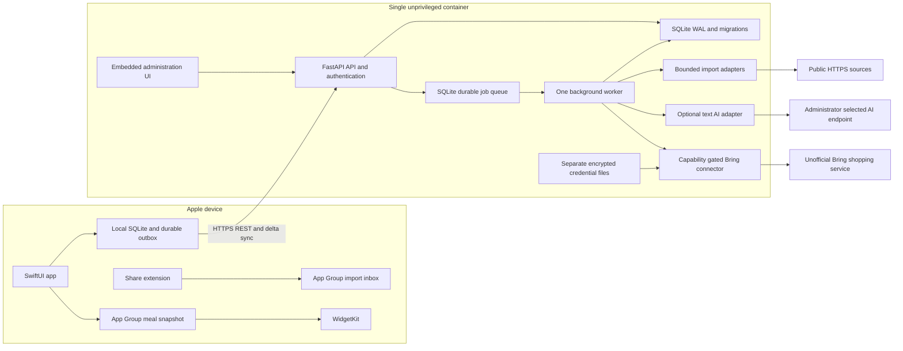

# Architecture and confirmed constraints

One Docker installation serves one household. Devices share household credentials but have
separate device IDs and revocable sessions. The native app reads and edits its local SQLite
store immediately; internet connectivity is not required for those operations. The backend
commits mutations in server order and asynchronously reconciles the current shopping week.
Imported content is previewed before a recipe can be saved.

The diagram describes paths being implemented. Bounded photo storage and media-aware
restore are tested. Native photo/calendar interfaces still need Apple SDK validation;
share lifecycle and several configuration screens remain incomplete. Consult the checklist.

## Technology decisions

See ADRs for the Python/TypeScript/Go evaluation, SQLite storage, sync protocol, integration
safety and license rationale. Python 3.12 and FastAPI were selected for explicit schemas,
OpenAPI generation, mature parsers and the replaceable Python Bring library. The process has
one API event loop and one worker; blocking domain/SQLite work runs outside the event loop.
SQLite connections are short-lived with foreign keys, FULL synchronous mode, WAL and a
busy timeout. Transactions use `BEGIN IMMEDIATE`. Only one server process is supported.

The durable queue uses atomic leases, fencing tokens, retry backoff and generations. A new
calendar change arriving during an in-flight job increments its generation. The worker
cannot incorrectly declare that new work complete. A single worker owns remote mutation
ordering. Jobs survive container restarts.

## Data and trust boundaries

Entity UUIDs are stable across device/server lifetimes. Whole entity snapshots make each
write atomic. Indexed relational domain projections are updated in the same transaction.
Ingredient numbers use decimal strings, avoiding floating-point arithmetic and guessed
mass/volume conversions. Date-only meal fields are independent of UTC mutation timestamps.
Household IANA time zone determines shopping weeks.

Recipes are soft-deleted. Server tombstones reject stale upserts even if an offline device
has a later wall clock. A user who intentionally restores content must use a new UUID.
No tombstone or mutation retention cleanup is enabled yet; unbounded growth is an explicit
release blocker rather than silently expiring an active device's safety information.

Secrets are not sent to iOS. Imported URLs are public-HTTPS only, DNS is checked for all
answers, sockets connect to validated addresses, and TLS verifies the original hostname.
Each redirect is independently checked. AI endpoints are administrator configuration and
cannot be changed by a recipe's content. Local AI over HTTP requires an explicit operator
configuration. Output validation does not establish factual accuracy; user review remains
mandatory.
